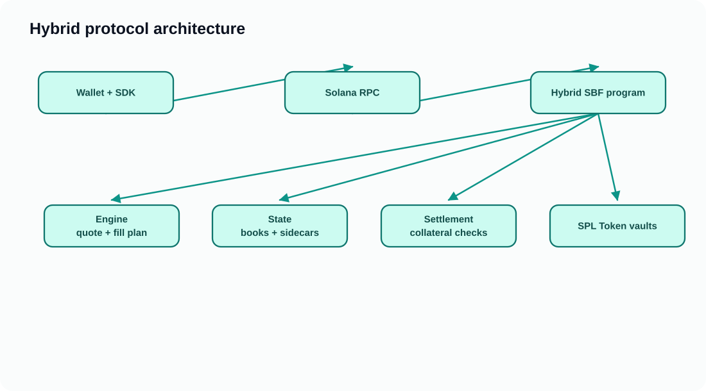
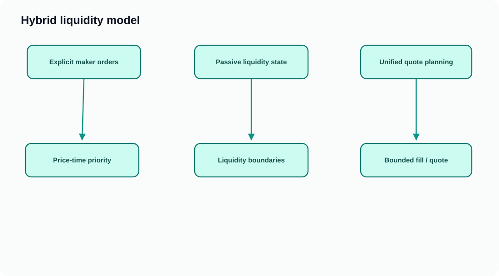
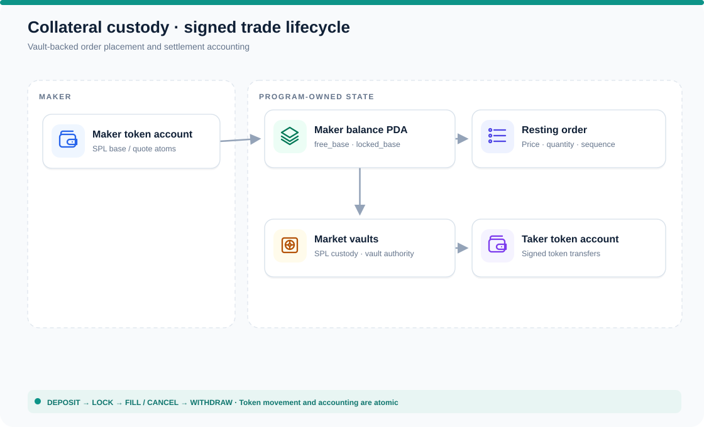
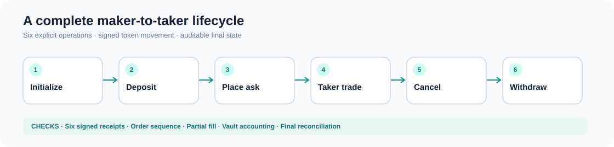

# Hybrid

**Solana-native order-book execution, with a compressed-passive liquidity architecture.**

Hybrid combines explicit price-time-prioritized limit orders with a deterministic engine for active and passive liquidity planning. The Solana program enforces account authentication, collateralized maker balances, SPL Token vault custody and bounded settlement.

> **Status:** The complete six-stage, funded **local Surfpool** maker/taker lifecycle has been verified with six signed receipts, a partial fill audit and final balance reconciliation. This is **not** a claim of public-devnet or mainnet deployment readiness.

## Why Hybrid

Hybrid is built for markets that need **explicit price-time execution**, deterministic fill accounting and program-enforced maker collateral—not just a black-box swap quote. The architecture combines a conventional active limit-order book with compressed passive pricing primitives, and separates execution planning, persistent state and settlement into independently testable components.

| For | Benefit |
| --- | --- |
| **Traders** | Exact-in/out constraints, visible resting orders and verifiable token settlement |
| **Market makers** | Inventory-aware collateral locks, partial-fill accounting and cancellation controls |
| **Protocol designers** | Reusable Rust engine/state/settlement boundaries and deterministic testing |
| **DEX operators** | A Solana-native executable, documented account graph and reproducible lifecycle audit |

See **[Why Hybrid](./docs/start/why-hybrid.mdx)**, **[For traders](./docs/audiences/traders.mdx)**, **[For market makers](./docs/audiences/market-makers.mdx)**, and **[For DEX teams](./docs/audiences/dex-teams.mdx)**.

## Architecture



[Edit the architecture diagram in Excalidraw](docs/assets/diagrams/architecture.excalidraw).

## Core concepts

Hybrid combines two liquidity models:

- **Active CLOB orders:** priced, time-prioritized maker asks and bids with explicit quantities and parallel ownership sidecars.
- **Compressed passive liquidity:** a liquidity/price boundary model used by the deterministic quote engine; execution coverage depends on the selected instruction path.



[Edit the liquidity diagram in Excalidraw](docs/assets/diagrams/liquidity.excalidraw).

**Custody and execution:** Makers deposit SPL tokens into market vaults, then lock collateral when placing orders. Taker fills consume locked balances, atomically transfer SPL tokens, and credit the received asset to maker balances. Cancel releases the unfilled reserve; only free collateral is withdrawable.



[Edit the custody architecture diagram in Excalidraw](docs/assets/diagrams/custody.excalidraw).

## A complete trading lifecycle



[Edit the lifecycle diagram](docs/assets/diagrams/lifecycle.excalidraw) · [Market launch guide](./docs/deployment/launch-market.mdx) · [Operational runbook](./docs/deployment/operator-runbook.mdx)

## 📚 Developer documentation

**[Explore the Mintlify documentation source →](./docs/index.mdx)**

| Start here | What you'll learn |
| --- | --- |
| [Quickstart](./docs/start/quickstart.mdx) | Clone, test and run the developer harness |
| [Protocol concepts](./docs/concepts/hybrid-liquidity.mdx) | Active orders, passive liquidity and execution boundaries |
| [System architecture](./docs/architecture/overview.mdx) | Rust crates, SBF program, account relationships and trust boundaries |
| [Account model](./docs/architecture/accounts.mdx) | Canonical PDAs, vaults and owner sidecars |
| [Instruction reference](./docs/architecture/instructions.mdx) | Core opcodes, byte layouts and account-order caveats |
| [Surfpool deployment](./docs/deployment/local-surfpool.mdx) | Reproduce the funded lifecycle on an isolated local runtime |
| [Public devnet prerequisites](./docs/deployment/public-devnet.mdx) | What a genuine network deployment requires |
| [Security and testing](./docs/operations/testing-and-security.mdx) | Verification gates, boundaries and invariants |

**Docs:** Mintlify Palm design with teal-on-slate accents, rich icons, and editable Excalidraw diagrams. The site source lives in `docs/`.

## Repository layout

```text
crates/engine      deterministic execution plans and quotes
crates/state       market, order page and owner-sidecar layouts
crates/settlement  free/locked collateral and settlement invariants
program/           Solana on-chain SBF entrypoint and handlers
devnet-demo/       wallet smoke UI and funded local integration runner
ci/                Rust/SBF tests, byte/CU budgets and fuzz checks
docs/              Mintlify developer portal
```

## Run tests

```bash
cargo fmt --all -- --check
cargo test --workspace
cd devnet-demo && npm install && npm test && npm run build
```

Full deterministic native/SBF/fuzz/CU validation is available through `bash ci/run.sh` with the toolchain configured. The [funded Surfpool GitHub Actions workflow](./.github/workflows/surfpool-funded.yml) provides the end-to-end, signed-transaction integration gate.

## Proof and provenance

The local funded lifecycle (initialize → deposit → place → trade → cancel → withdraw) and independent receipt verification were delivered by [PR #59](https://github.com/en0ma/hybrid/pull/59) and tracked in [Issue #60](https://github.com/en0ma/hybrid/issues/60). The authoritative logic remains the repository code and its tests; documentation describes that implementation, not unverified features.

## Contributing

See [the contribution guide](./docs/contributing.mdx). Hybrid is licensed under Apache-2.0 (see workspace configuration).
