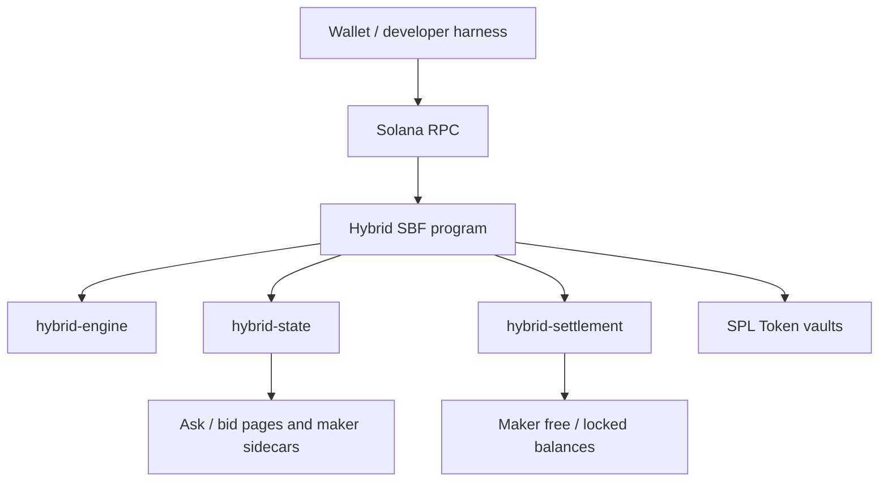

## Repository map

```text
hybrid/
├── crates/
│   ├── engine/       # deterministic quoting and fill planning
│   ├── state/        # account layouts, pages and link validation
│   └── settlement/   # maker collateral and settlement checks
├── program/          # Solana SBF entrypoint and instruction handlers
├── devnet-demo/      # Vite wallet interface + funded Surfpool runner
├── ci/               # deterministic Rust/SBF/fuzz/CU checks
└── .github/workflows/# PR gates and funded integration evidence
```

## Execution boundary



## Trust boundaries

- **Client:** Builds instructions, supplies accounts, requests wallet signatures and reads receipts.
- **Program:** Re-derives canonical addresses, validates owners/signatures and enforces the collateralized ABI.
- **SPL Token:** Moves actual token balances with signed authority.
- **Independent audit:** Re-reads transactions and state to validate settlement outcomes.

For the account-level layout, continue to [Accounts and PDAs](/architecture/accounts).
